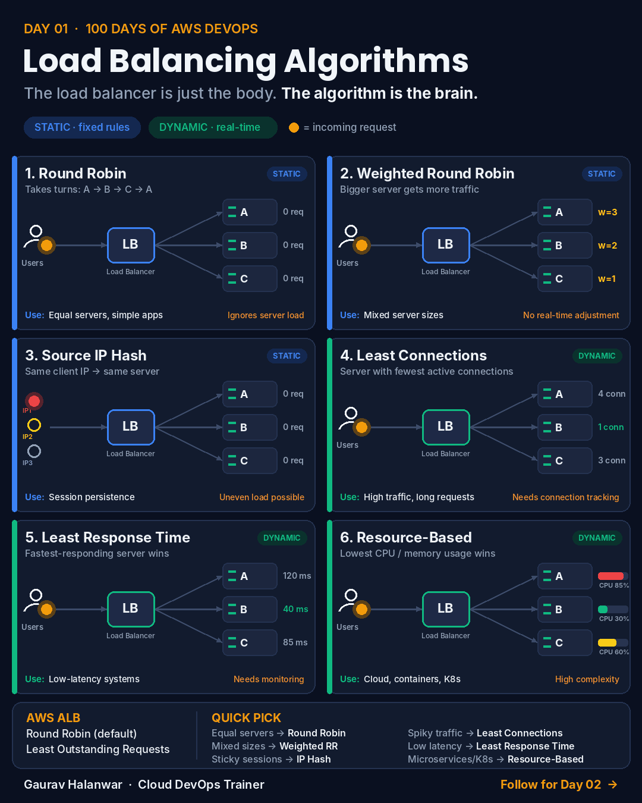
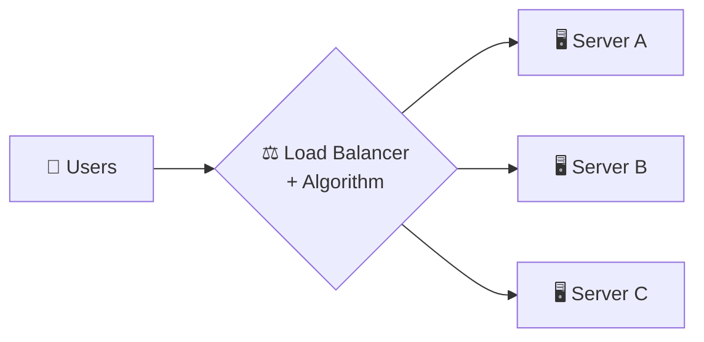
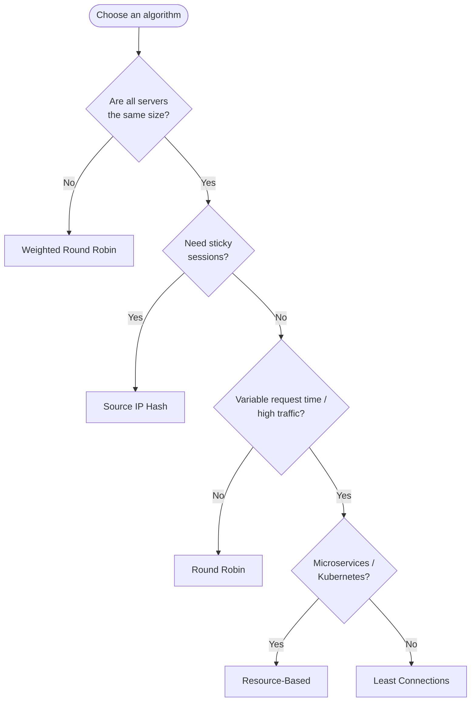

# Day 01 — Load Balancing Algorithms ⚖️

> **100 Days of AWS DevOps** · by **Gaurav Halanwar** · Cloud DevOps Trainer

<p align="center">
  
</p>

<p align="center">
  <a href="https://www.linkedin.com/in/gaurav-halnawar/"></a>
  <a href="https://chat.whatsapp.com/Jbzc5caZMEWElHLmKKZpfg"></a>
</p>

---

## 📌 Table of Contents

1. [What is a Load Balancing Algorithm?](#1-what-is-a-load-balancing-algorithm)
2. [Why Algorithms Matter](#2-why-algorithms-matter)
3. [Types of Algorithms](#3-types-of-load-balancing-algorithms)
4. [Static Algorithms](#4-static-algorithms-basic-level)
5. [Dynamic Algorithms](#5-dynamic-algorithms-advanced-level)
6. [Static vs Dynamic](#6-static-vs-dynamic-interview-table)
7. [How AWS ELB Uses This](#7-how-aws-elb-uses-this)
8. [Real-Life Scenario](#8-real-life-scenario)
9. [Production Decision Logic](#9-production-decision-logic)
10. [Key Factors for Choosing](#10-key-factors-for-choosing-an-algorithm)
11. [Common Mistakes](#11-common-mistakes)
12. [Interview Questions](#12-interview-questions)
13. [Hands-On Lab (AWS)](#13-hands-on-lab-aws)
14. [Final Insight](#14-final-insight)

---

## 1. What is a Load Balancing Algorithm?

**Interview definition:**
A load balancing algorithm is the method a load balancer uses to spread incoming requests across multiple servers. The goal is to use resources well, stay highly available, and keep performance high.

> 💡 **Golden Line:** *"The algorithm decides which server gets the next request."*



---

## 2. Why Algorithms Matter

| ❌ Without an algorithm | ✅ With an algorithm |
|---|---|
| Random traffic distribution | Balanced traffic |
| Some servers overloaded | Better performance |
| Some servers idle | High availability |

---

## 3. Types of Load Balancing Algorithms

| Type | Description |
|---|---|
| 🔵 **Static** | Predefined rules · no real-time monitoring |
| 🟢 **Dynamic** | Based on real-time server condition · more intelligent |

---

## 4. Static Algorithms (Basic Level)

### 4.1 Round Robin

**How it works:**
```
Request 1 → Server A
Request 2 → Server B
Request 3 → Server C
Request 4 → Server A   (repeat)
```
- ✅ **Use case:** Equal servers, simple apps
- ⚠️ **Problem:** Ignores server load

### 4.2 Weighted Round Robin

**How it works:**
```
Server A (weight 2) → gets 2 requests
Server B (weight 1) → gets 1 request
```
👉 Server A gets **double** the traffic.

- ✅ **Use case:** Servers with different capacity
- ⚠️ **Limitation:** Still static (no real-time adjustment)

### 4.3 Source IP Hash

**How it works:**
```
hash(Client IP) % N  →  same client IP → same server
```
- ✅ **Use case:** Session persistence (sticky sessions)
- ⚠️ **Problem:** Uneven load is possible

---

## 5. Dynamic Algorithms (Advanced Level)

### 5.1 Least Connections

👉 Sends the request to the server with the **fewest active connections**.

```
Server A: 4 conn
Server B: 1 conn   ← next request goes here ✅
Server C: 3 conn
```
- ✅ **Use case:** High-traffic systems, long-running requests
- 🎯 **Benefit:** Better load distribution

### 5.2 Least Response Time

👉 Sends the request to the **fastest-responding** server.

```
Server A: 120 ms
Server B:  40 ms   ← next request goes here ✅
Server C:  85 ms
```
- ✅ **Use case:** Low-latency systems
- ⚠️ **Challenge:** Needs monitoring

### 5.3 Resource-Based

👉 Picks the server with the **lowest CPU / memory usage**.

```
Server A: CPU 85%
Server B: CPU 30%  ← next request goes here ✅
Server C: CPU 60%
```
- ✅ **Use case:** Cloud / container systems
- ⚠️ **Complexity:** High (needs an agent or metrics on each server)

---

## 6. Static vs Dynamic (Interview Table)

| Feature | 🔵 Static | 🟢 Dynamic |
|---|---|---|
| Decision | Fixed | Real-time |
| Performance | Basic | Optimized |
| Complexity | Low | High |
| Adaptability | No | Yes |

---

## 7. How AWS ELB Uses This

AWS hides the complexity, but under the hood it uses:

| AWS Service | Algorithm |
|---|---|
| **ALB** (Application Load Balancer) | Round Robin (default) · **Least Outstanding Requests** (optional) · Weighted target groups |
| **NLB** (Network Load Balancer) | Flow hash (source/destination IP, port, protocol) |
| **Route 53** | Weighted routing · Latency-based routing |

> 🛠️ On ALB, change it in: **Target Group → Attributes → Load balancing algorithm**

---

## 8. Real-Life Scenario

### 🛒 E-commerce website during a sale

| | |
|---|---|
| **Problem** | Huge traffic spike during the sale |
| **Solution** | Load balancer spreads requests across the server fleet |
| **Best algorithm** | **Least Connections** + **Weighted Round Robin** |

---

## 9. Production Decision Logic



| Algorithm | When to use |
|---|---|
| Round Robin | Small app, equal servers |
| Weighted Round Robin | Mixed server sizes |
| Least Connections | High traffic, variable request time |
| Least Response Time | Latency-sensitive APIs |
| Resource-Based | Microservices / Kubernetes |

---

## 10. Key Factors for Choosing an Algorithm

- 📈 Traffic pattern
- 🖥️ Server capacity
- ⏱️ Latency requirements
- 💰 Cost

---

## 11. Common Mistakes

- ❌ Always using Round Robin
- ❌ Ignoring server capacity
- ❌ Not monitoring performance

---

## 12. Interview Questions

<details>
<summary><b>Q1: Round Robin vs Least Connections?</b></summary>

- **Round Robin** → sends requests in order, ignoring current load.
- **Least Connections** → checks live connection counts and sends to the least busy server.
</details>

<details>
<summary><b>Q2: Why are dynamic algorithms better?</b></summary>

They adapt to real-time load, so slow or busy servers don't become bottlenecks.
</details>

<details>
<summary><b>Q3: When should you use IP Hash?</b></summary>

For session-based apps where a user must keep hitting the same server (for example, sessions stored in local memory).
</details>

<details>
<summary><b>Q4: Which algorithm does AWS ALB use by default?</b></summary>

Round Robin. You can switch a target group to **Least Outstanding Requests**.
</details>

---

## 13. Hands-On Lab (AWS)

1. Launch **3 EC2 instances** (Amazon Linux, `t2.micro`, Free Tier).
2. Install a web server on each that returns its own name:
   ```bash
   #!/bin/bash
   yum install -y httpd
   echo "<h1>Hello from $(hostname -f)</h1>" > /var/www/html/index.html
   systemctl enable --now httpd
   ```
3. Create a **Target Group** and register all 3 instances.
4. Create an **Application Load Balancer** and attach the target group.
5. Open the ALB DNS name and refresh a few times. You'll see Round Robin in action 🔁
6. Change the algorithm to **Least Outstanding Requests** under Target Group → Attributes.
7. 🧹 **Clean up:** delete the ALB, target group, and EC2 instances to avoid charges.

---

## 14. Final Insight

> 👉 A load balancer isn't intelligent by default.
> 👉 **The algorithm is the actual brain.**

---

## 🤝 Join the Journey

- 💬 **WhatsApp Community:** [Join here](https://chat.whatsapp.com/Jbzc5caZMEWElHLmKKZpfg)
- 🔗 **LinkedIn:** [Follow Gaurav Halanwar](https://www.linkedin.com/in/gaurav-halnawar/)

⭐ **Star this repo** to follow all 100 days · ➡️ **Next: Day 02 — ALB vs NLB vs GWLB**