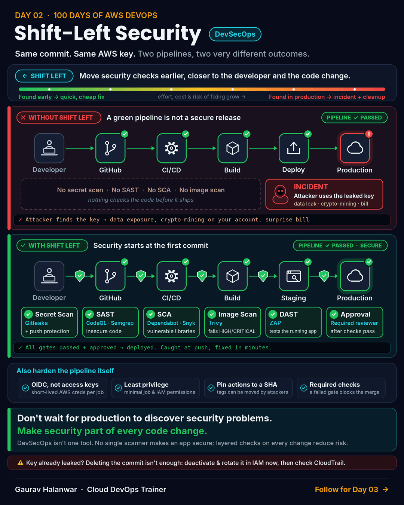
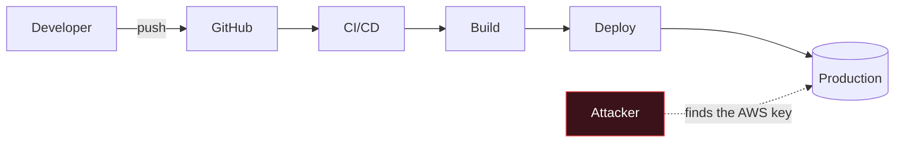
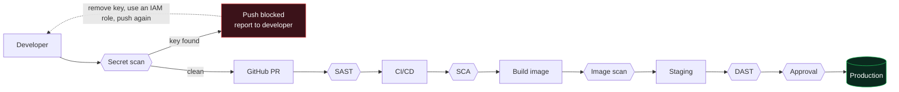

# Day 02: Shift-Left Security (DevSecOps)

> **100 Days of AWS DevOps** · by **Gaurav Halanwar** · Cloud DevOps Trainer

<p align="center">
  
</p>

<p align="center">
  <a href="https://www.linkedin.com/in/gaurav-halnawar/"></a>
  <a href="https://chat.whatsapp.com/Jbzc5caZMEWElHLmKKZpfg"></a>
</p>

**TL;DR.** A green pipeline only proves your code built and deployed. It says nothing about whether the code is safe. *Shift left* means moving security checks earlier (to the commit, the pull request and the build), where problems are faster, cheaper and less risky to fix.

---

## Contents

1. [The story: a small mistake, a big incident](#1-the-story-a-small-mistake-a-big-incident)
2. [What is Shift Left?](#2-what-is-shift-left)
3. [What is DevSecOps?](#3-what-is-devsecops)
4. [Same commit, two pipelines](#4-same-commit-two-pipelines)
5. [The security gates](#5-the-security-gates)
6. [Hands-on: build the pipeline](#6-hands-on-build-the-pipeline)
7. [Already leaked a key? Do this now](#7-already-leaked-a-key-do-this-now)
8. [Without vs with Shift Left](#8-without-vs-with-shift-left)
9. [Common mistakes](#9-common-mistakes)
10. [Interview questions](#10-interview-questions)
11. [Final insight](#11-final-insight)

---

## 1. The story: a small mistake, a big incident

A developer joins the team on Monday. They don't know the security process yet.

1. To get a feature working, they paste an AWS access key into `config.py`.
2. They commit and push the code to GitHub.
3. The CI/CD pipeline starts automatically.
4. The pipeline has **no security checks**, so build and deploy both succeed.
5. The app goes to production with the key inside it.
6. An attacker finds the key and uses it: data exposure, crypto-mining on your account, a surprise bill.

**The pipeline never failed.** It did exactly what it was built to do: ship code. Nobody asked it to check whether the code was safe.

> **This is not hypothetical.** Palo Alto Networks' Unit 42 tracked a campaign called *EleKtra-Leak* in which attackers found AWS IAM credentials exposed in public GitHub repositories and used them **within about five minutes**, launching EC2 instances for crypto-mining.

---

## 2. What is Shift Left?

> **Shift Left = move security checks earlier in the software delivery process, closer to the developer and the code change.**

Picture the delivery process as a timeline from left (writing code) to right (running in production). Traditionally, security checks sat at the far right, just before or after release. Shift left moves them toward the start.

```
 Code ──► Commit ──► Pull Request ──► Build ──► Staging ──► Production
   ◄────────────── shift security checks this way ──────────────
```

### Why earlier is better

| Where the problem is found | What fixing it involves |
|---|---|
| On the developer's laptop (pre-commit) | Edit one file. Nobody else is affected. |
| In the pull request | A failed check, a fix, a re-run. Still private to the team. |
| In the build or staging | Rebuild, redeploy, retest. |
| **In production** | Incident response, key rotation, log forensics, maybe customer notifications, and the cost of whatever the attacker ran. |

> **Interview tip:** you'll often see "a bug costs 100x more to fix in production" quoted with a chart from an "IBM Systems Sciences Institute". The original source of that number is disputed. Explain *why* late fixes cost more (the table above) instead of quoting the ratio.

---

## 3. What is DevSecOps?

**DevSecOps** makes security a shared, automated part of the DevOps pipeline, instead of a separate team's sign-off at the end.

It rests on three ideas:

- **Automate it.** Checks run on every push and pull request, not once a quarter.
- **Do it early and continuously.** Every stage has its own checks.
- **Share ownership.** Developers get the findings directly and fix them in their own workflow.

> DevSecOps is not one tool. **No single scanner makes an application secure.** Layers of checks on every change reduce risk.

---

## 4. Same commit, two pipelines

### Without Shift Left: security comes too late



Every stage shows green. The key still reaches production.

### With Shift Left: security starts at the first commit



The same mistake is caught at push and fixed in minutes. Production only gets code that has passed every gate.

---

## 5. The security gates

| # | Gate | What it catches | Where it runs | Tools | Blocks when |
|---|---|---|---|---|---|
| 1 | **Secret scanning** | Hardcoded keys, tokens, passwords | Pre-commit hook, at push, in CI | Gitleaks, GitHub secret scanning + push protection, TruffleHog | Any secret is found |
| 2 | **SAST** (Static Application Security Testing) | Insecure code patterns, without running the app (SQL injection, command injection, weak crypto) | Pull request / CI | CodeQL, Semgrep, SonarQube | Findings at or above your severity threshold |
| 3 | **SCA** (Software Composition Analysis) | Known vulnerabilities (CVEs) in third-party libraries | Repo + pull request / CI | Dependabot, Snyk, Trivy (`fs`), OWASP Dependency-Check | HIGH/CRITICAL with a fix available |
| 4 | **Container image scanning** | Vulnerable OS packages and libraries inside the image | After `docker build`, before push/deploy | Trivy, Grype, Amazon ECR scanning (Amazon Inspector) | HIGH/CRITICAL, per team policy |
| 5 | **DAST** (Dynamic Application Security Testing) | Weaknesses in the **running** app: missing security headers, insecure cookies, some XSS | Staging or a dedicated test environment | ZAP (formerly OWASP ZAP), Burp Suite | Alerts your rules mark as FAIL |
| + | **IaC scanning** (bonus) | Risky Terraform / CloudFormation / Kubernetes config (public S3 bucket, `0.0.0.0/0` on SSH) | Pull request / CI | Checkov, Trivy (`config`) | HIGH/CRITICAL |
| 6 | **Pipeline and deployment security** | Stolen CI credentials, compromised third-party actions, unreviewed production deploys | The pipeline itself | OIDC, least-privilege permissions, SHA-pinned actions, environment approvals, required checks | — |

### Notes that matter in real projects

- **Secret scanning works best in layers.** A pre-commit hook stops the key on the laptop. GitHub push protection stops it at `git push`. CI scanning catches anything that slipped past both. If a real key ever reached a remote, **revoke or rotate it immediately**, even if the scanner caught it.
- **SAST reads code; DAST attacks a running app.** They find different bugs. You want both.
- **SCA and image scanning only know about *known* vulnerabilities.** A clean report means "no known CVEs at your threshold", not "secure".
- **DAST belongs in staging.** Active scans send attack-like traffic. Only scan targets you own and are authorised to test, and never run an active scan against production.
- **OIDC doesn't scan anything.** It removes the need to store long-lived AWS keys in CI at all, so there's nothing to leak. Each job gets short-lived credentials that expire on their own.
- **Approval is an extra control, not a replacement.** A human reviewer won't spot a CVE in a base image. Automated gates first, then approval.

---

## 6. Hands-on: build the pipeline

Suggested layout for this day's folder:

```
day-02-shift-left-security/
├── README.md
├── assets/
│   └── day02_shift_left_security.gif
├── .pre-commit-config.yaml
└── .github/
    ├── dependabot.yml
    └── workflows/
        └── devsecops.yml
```

> GitHub only runs workflows from `.github/workflows/` at the **root** of a repository. To try this pipeline, copy the files into a separate practice repo.

### 6.1 Stop secrets on the laptop (pre-commit + Gitleaks)

`.pre-commit-config.yaml`

```yaml
repos:
  - repo: https://github.com/gitleaks/gitleaks
    rev: v8.30.1
    hooks:
      - id: gitleaks
```

```bash
pip install pre-commit
pre-commit install            # runs Gitleaks on staged changes before every commit
gitleaks git -v               # one-off scan of the whole git history
```

### 6.2 Turn on GitHub's built-in protection

In your repo: **Settings → Advanced Security** (called *Code security* on some accounts):

- **Secret scanning + push protection:** free for public repositories. For private repos you need GitHub Secret Protection. Push protection for users is also on by default for pushes to public repos.
- **Dependabot alerts and security updates:** available for all repositories.
- **CodeQL code scanning ("Default setup"):** free for public repositories. For private repos you need GitHub Code Security.

### 6.3 The pipeline: `.github/workflows/devsecops.yml`

Every third-party action is **pinned to a full commit SHA**, with the version in a comment. Set these as repository **variables** (Settings → Secrets and variables → Actions → Variables): `AWS_REGION`, `ECR_REGISTRY`, `AWS_ROLE_BUILD`, `AWS_ROLE_STAGING`, `AWS_ROLE_PROD`, `STAGING_URL`. None of them are secrets.

```yaml
name: devsecops

on:
  pull_request:
    branches: [main]
  push:
    branches: [main]

# Least privilege: the default token gets nothing. Each job asks only for what it needs.
permissions: {}

jobs:
  # 1. Secrets: fail if a credential is in this push / PR
  secret-scan:
    runs-on: ubuntu-latest
    permissions:
      contents: read
      pull-requests: read
    steps:
      - uses: actions/checkout@3d3c42e5aac5ba805825da76410c181273ba90b1 # v7.0.1
        with:
          fetch-depth: 0               # Gitleaks scans the commits in the push / PR
          persist-credentials: false
      - uses: gitleaks/gitleaks-action@e0c47f4f8be36e29cdc102c57e68cb5cbf0e8d1e # v3.0.0
        env:
          GITHUB_TOKEN: ${{ secrets.GITHUB_TOKEN }}
          GITLEAKS_LICENSE: ${{ secrets.GITLEAKS_LICENSE }}  # free key; only needed for organization-owned repos
          GITLEAKS_ENABLE_COMMENTS: false

  # 2. SAST: insecure code patterns, without running the app
  sast:
    runs-on: ubuntu-latest
    permissions:
      contents: read
    steps:
      - uses: actions/checkout@3d3c42e5aac5ba805825da76410c181273ba90b1 # v7.0.1
        with:
          persist-credentials: false
      - name: Semgrep (fails the job on findings)
        run: |
          pipx install semgrep==1.186.0
          semgrep scan --config p/default --error --metrics=off

  # 3. SCA: known vulnerabilities in third-party dependencies
  sca:
    runs-on: ubuntu-latest
    permissions:
      contents: read
    steps:
      - uses: actions/checkout@3d3c42e5aac5ba805825da76410c181273ba90b1 # v7.0.1
        with:
          persist-credentials: false
      - uses: aquasecurity/trivy-action@ed142fd0673e97e23eac54620cfb913e5ce36c25 # v0.36.0
        with:
          scan-type: fs
          scan-ref: .
          scanners: vuln
          severity: HIGH,CRITICAL
          ignore-unfixed: true
          exit-code: "1"

  # 4. Build the image, scan it, and (on main only) push the exact image that was scanned
  build-and-scan:
    needs: [secret-scan, sast, sca]
    runs-on: ubuntu-latest
    permissions:
      contents: read
      id-token: write                  # used only on main, to get short-lived AWS creds via OIDC
    steps:
      - uses: actions/checkout@3d3c42e5aac5ba805825da76410c181273ba90b1 # v7.0.1
        with:
          persist-credentials: false
      - name: Build image
        run: docker build -t "app:$GITHUB_SHA" .
      - name: Trivy image scan (fails on HIGH/CRITICAL)
        uses: aquasecurity/trivy-action@ed142fd0673e97e23eac54620cfb913e5ce36c25 # v0.36.0
        with:
          image-ref: app:${{ github.sha }}
          severity: HIGH,CRITICAL
          ignore-unfixed: true
          exit-code: "1"
      - name: AWS credentials via OIDC (no stored keys)
        if: github.event_name == 'push'
        uses: aws-actions/configure-aws-credentials@e1253824e5c10ff9df46874f81ed3ec929e19cfd # v6.3.0
        with:
          role-to-assume: ${{ vars.AWS_ROLE_BUILD }}
          aws-region: ${{ vars.AWS_REGION }}
      - name: Push the scanned image to ECR
        if: github.event_name == 'push'
        env:
          REGISTRY: ${{ vars.ECR_REGISTRY }}
        run: |
          aws ecr get-login-password | docker login --username AWS --password-stdin "$REGISTRY"
          docker tag "app:$GITHUB_SHA" "$REGISTRY/app:$GITHUB_SHA"
          docker push "$REGISTRY/app:$GITHUB_SHA"

  deploy-staging:
    needs: build-and-scan
    if: github.event_name == 'push'
    runs-on: ubuntu-latest
    environment: staging
    permissions:
      contents: read
      id-token: write
    steps:
      - uses: actions/checkout@3d3c42e5aac5ba805825da76410c181273ba90b1 # v7.0.1
        with:
          persist-credentials: false
      - uses: aws-actions/configure-aws-credentials@e1253824e5c10ff9df46874f81ed3ec929e19cfd # v6.3.0
        with:
          role-to-assume: ${{ vars.AWS_ROLE_STAGING }}
          aws-region: ${{ vars.AWS_REGION }}
      - name: Deploy to staging
        run: ./scripts/deploy.sh staging "$GITHUB_SHA"   # your ECS / EKS / App Runner rollout

  # 5. DAST: test the running app in staging
  dast:
    needs: deploy-staging
    runs-on: ubuntu-latest
    permissions:
      contents: read
    steps:
      - uses: actions/checkout@3d3c42e5aac5ba805825da76410c181273ba90b1 # v7.0.1
        with:
          persist-credentials: false
      - uses: zaproxy/action-baseline@de8ad967d3548d44ef623df22cf95c3b0baf8b25 # v0.15.0
        with:
          target: ${{ vars.STAGING_URL }}
          fail_action: true            # fail the job when ZAP raises alerts
          allow_issue_writing: false   # don't open GitHub issues
          # rules_file_name: .zap/rules.tsv   # tune which alerts FAIL, WARN or are IGNOREd

  # 6. Production: only after every gate passes AND a human approves
  deploy-prod:
    needs: dast
    runs-on: ubuntu-latest
    environment: production            # add "Required reviewers" to this environment
    permissions:
      contents: read
      id-token: write
    steps:
      - uses: actions/checkout@3d3c42e5aac5ba805825da76410c181273ba90b1 # v7.0.1
        with:
          persist-credentials: false
      - uses: aws-actions/configure-aws-credentials@e1253824e5c10ff9df46874f81ed3ec929e19cfd # v6.3.0
        with:
          role-to-assume: ${{ vars.AWS_ROLE_PROD }}
          aws-region: ${{ vars.AWS_REGION }}
      - name: Deploy to production
        run: ./scripts/deploy.sh production "$GITHUB_SHA"
```

> **Why the SHA pinning?** In March 2025 the popular `tj-actions/changed-files` action was compromised. Attackers moved its existing version tags to a malicious commit that dumped CI secrets into build logs, affecting about 23,000 repositories (CVE-2025-30066). A tag can be moved; a full commit SHA can't.

> ZAP's baseline scan treats many low-risk findings as warnings. With `fail_action: true` the job fails on any alert, so add a rules file once you know which alerts matter for your app.

### 6.4 AWS side: an OIDC role instead of access keys

**Step 1.** In IAM go to **Identity providers → Add provider → OpenID Connect**:
- Provider URL: `https://token.actions.githubusercontent.com`
- Audience: `sts.amazonaws.com`

**Step 2.** Create a role for each environment. This trust policy lets only jobs that use the `production` environment of *your* repo assume the production role:

```json
{
  "Version": "2012-10-17",
  "Statement": [
    {
      "Effect": "Allow",
      "Principal": {
        "Federated": "arn:aws:iam::<ACCOUNT_ID>:oidc-provider/token.actions.githubusercontent.com"
      },
      "Action": "sts:AssumeRoleWithWebIdentity",
      "Condition": {
        "StringEquals": {
          "token.actions.githubusercontent.com:aud": "sts.amazonaws.com",
          "token.actions.githubusercontent.com:sub": "repo:<OWNER>/<REPO>:environment:production"
        }
      }
    }
  ]
}
```

- For the build role (pushes from `main`), use `"repo:<OWNER>/<REPO>:ref:refs/heads/main"` as the `sub`.
- Give each role **only** the permissions its job needs: ECR push for the build role, a service update for the deploy roles. Never use `AdministratorAccess`.

### 6.5 Make the gates actually block

A scanner that only *reports* protects nothing. In GitHub:

1. **Settings → Rules → Rulesets → New branch ruleset**, targeting `main`:
   - Require a pull request before merging.
   - Require status checks to pass: `secret-scan`, `sast`, `sca`, `build-and-scan`.
2. **Settings → Environments → production**: add **Required reviewers**. This works on public repos on every plan; for private repos, check what your GitHub plan includes.

### 6.6 Keep dependencies and action pins fresh: `.github/dependabot.yml`

```yaml
version: 2
updates:
  - package-ecosystem: "pip"            # or npm, maven, gomod, docker ...
    directory: "/"
    schedule:
      interval: "weekly"
  - package-ecosystem: "github-actions" # opens PRs that bump your SHA-pinned actions
    directory: "/"
    schedule:
      interval: "weekly"
```

### 6.7 Run the scanners locally

```bash
gitleaks dir .                                                    # secrets in the working directory
semgrep scan --config p/default                                   # SAST
trivy fs --scanners vuln --severity HIGH,CRITICAL .               # SCA
trivy config .                                                    # IaC: Terraform, K8s, Dockerfile
trivy image --severity HIGH,CRITICAL --ignore-unfixed --exit-code 1 app:latest
docker run --rm -t ghcr.io/zaproxy/zaproxy:stable zap-baseline.py -t https://staging.example.com
```

---

## 7. Already leaked a key? Do this now

Deleting the file or the commit is **not** enough. The key is still in git history, in forks and clones, and possibly already in an attacker's hands.

```bash
KEY_ID="AKIA................"     # the leaked access key ID
USER_NAME="the-iam-user"          # the IAM user that owns it

# 1. Kill it first. Investigate second.
aws iam update-access-key --user-name "$USER_NAME" --access-key-id "$KEY_ID" --status Inactive

# 2. What did it do? (CloudTrail event history is per region, so check every region you use)
aws cloudtrail lookup-events --region ap-south-1 \
  --lookup-attributes AttributeKey=AccessKeyId,AttributeValue="$KEY_ID"

# 3. Look for things the attacker left behind, e.g. instances in regions you never use
for r in $(aws ec2 describe-regions --query "Regions[].RegionName" --output text); do
  aws ec2 describe-instances --region "$r" \
    --query "Reservations[].Instances[].[InstanceId,InstanceType,LaunchTime]" --output text
done
aws iam list-users     # new users? new access keys? new roles?

# 4. Delete the key and replace it with a role (OIDC for CI, instance/task roles for apps)
aws iam delete-access-key --user-name "$USER_NAME" --access-key-id "$KEY_ID"
```

Then:
- Check **Billing / Cost Explorer** and **GuardDuty** for unusual activity.
- Clean the history with `git filter-repo`. This reduces future exposure but does **not** un-leak the key.
- Add the gates from section 6 so it can't happen again.

> AWS may detect a publicly exposed key and attach a quarantine policy to the user. Don't rely on it: attackers have been observed moving within minutes.

---

## 8. Without vs with Shift Left

| Without Shift Left | With Shift Left |
|---|---|
| Secret reaches production | Secret detected at commit or push |
| Security checked late, or never | Security checked on every change |
| Higher remediation cost and risk | Earlier, faster, cheaper fixes |
| Pipeline success mistaken for security | Security gates validate the release |
| Long-lived keys stored in CI | Short-lived OIDC credentials |

---

## 9. Common mistakes

- **Scanners in "report only" mode.** If the job exits `0`, nothing is blocked. Use `exit-code: 1` / `--error` and make the checks *required*.
- **Scanning only after merge.** By then the secret is already on `main`. Scan pull requests.
- **Thinking `.gitignore` protects you.** It doesn't remove files that are already tracked.
- **Long-lived AWS keys in GitHub Secrets** when OIDC is available.
- **Pinning actions to `@v4` or `@main`.** Tags and branches can be moved.
- **Failing on every LOW finding on day one.** Start with HIGH/CRITICAL, fix those, then tighten. Alert fatigue makes teams ignore everything.
- **Running active DAST against production.**
- **Treating manual approval as a substitute for automated checks.**

---

## 10. Interview questions

<details>
<summary><b>Q1. What is shift-left security?</b></summary>

Moving security checks earlier in the delivery process (pre-commit, pull request, build) so issues are found when they're cheapest and fastest to fix, instead of after release.
</details>

<details>
<summary><b>Q2. SAST vs DAST vs SCA?</b></summary>

| | SAST | DAST | SCA |
|---|---|---|---|
| Looks at | Your source code | The running app | Third-party dependencies |
| Needs the app running? | No | Yes | No |
| Typical stage | PR / CI | Staging | PR / CI + repo monitoring |
| Example tools | CodeQL, Semgrep | ZAP | Dependabot, Snyk, Trivy |
</details>

<details>
<summary><b>Q3. A secret was committed, then removed in the next commit. Are we safe?</b></summary>

No. It's still in git history, and anyone who cloned or forked the repo has it. Treat it as compromised: revoke/rotate it, check CloudTrail for usage, then clean the history.
</details>

<details>
<summary><b>Q4. Why use OIDC instead of storing AWS keys in GitHub Secrets?</b></summary>

With OIDC there's no long-lived key to leak. GitHub issues a signed token per job, AWS STS exchanges it for temporary credentials, and the trust policy limits which repo, branch or environment can assume the role. The credentials expire on their own.
</details>

<details>
<summary><b>Q5. Why pin GitHub Actions to a commit SHA?</b></summary>

Tags are mutable. In the March 2025 `tj-actions/changed-files` compromise, attackers repointed existing tags to a malicious commit that leaked CI secrets. A full commit SHA can't be changed to point at different code.
</details>

<details>
<summary><b>Q6. Trivy shows zero HIGH/CRITICAL. Is the image secure?</b></summary>

Not necessarily. It means there are no *known* CVEs at that severity. It says nothing about business-logic flaws, misconfiguration, weak IAM or zero-days. That's why you layer gates.
</details>

<details>
<summary><b>Q7. How do you add security gates without slowing developers down?</b></summary>

Run fast checks (secrets, SAST, SCA) in parallel on PRs; start with HIGH/CRITICAL only; use pre-commit hooks so most issues never reach CI; manage false positives with reviewed ignore files; send findings straight to the developer who made the change.
</details>

<details>
<summary><b>Q8. Where does manual approval fit?</b></summary>

As an extra control before production, after the automated gates pass. It doesn't replace them.
</details>

---

## 11. Final insight

> **Don't wait for production to discover security problems. Make security part of every code change.**
>
> A green pipeline tells you the code shipped. Security gates tell you it was safe to ship.

---

## Sources

- [Unit 42: EleKtra-Leak, exposed AWS IAM keys used within minutes](https://unit42.paloaltonetworks.com/malicious-operations-of-exposed-iam-keys-cryptojacking/)
- [CISA: tj-actions/changed-files supply chain compromise (CVE-2025-30066)](https://www.cisa.gov/news-events/alerts/2025/03/18/supply-chain-compromise-third-party-github-action-cve-2025-30066)
- [GitHub Docs: GitHub security features](https://docs.github.com/en/code-security/getting-started/github-security-features)
- [Gitleaks Action (license note for organizations)](https://github.com/gitleaks/gitleaks-action)
- [ZAP: no longer an OWASP project](https://www.zaproxy.org/docs/nowaspzap/)
- [The Register: the "100x cost" bug study may not exist](https://www.theregister.com/2021/07/22/bugs_expense_bs/)

---

## Join the journey

- 💬 **WhatsApp Community:** [Join here](https://chat.whatsapp.com/Jbzc5caZMEWElHLmKKZpfg)
- 🔗 **LinkedIn:** [Follow Gaurav Halanwar](https://www.linkedin.com/in/gaurav-halnawar/)

⭐ Star this repo to follow all 100 days · ⬅️ [Day 01: Load Balancing Algorithms](../day-01-load-balancing/) · ➡️ Day 03: coming tomorrow
