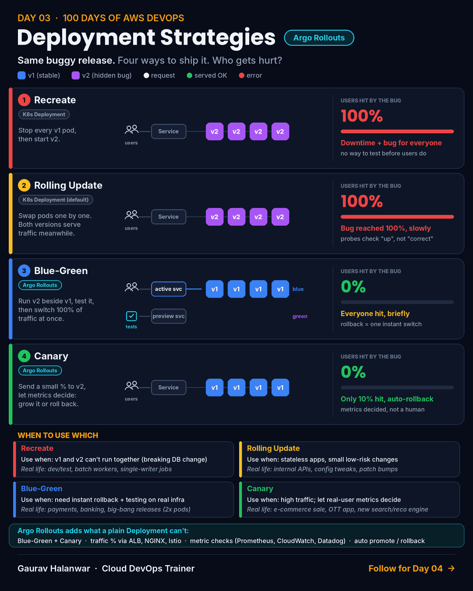
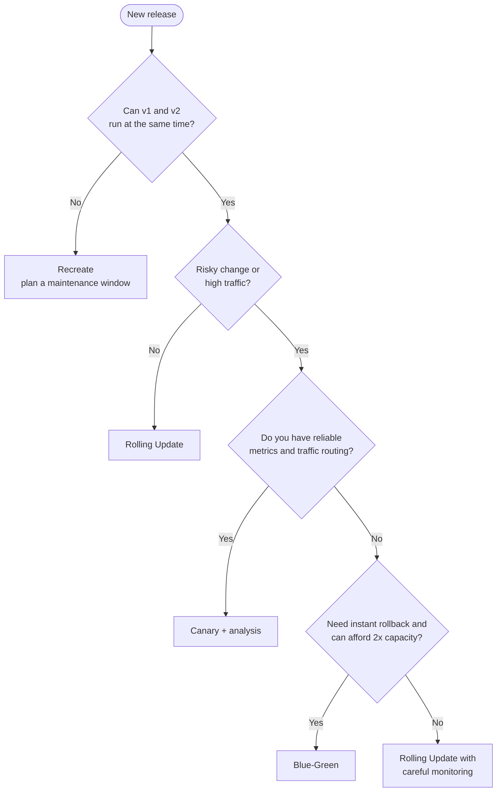

# Day 03: Deployment Strategies (Recreate · Rolling · Blue-Green · Canary) with Argo Rollouts

> **100 Days of AWS DevOps** · by **Gaurav Halanwar** · Cloud DevOps Trainer

<p align="center">
  
</p>

<p align="center">
  <a href="https://www.linkedin.com/in/gaurav-halnawar/"></a>
  <a href="https://chat.whatsapp.com/Jbzc5caZMEWElHLmKKZpfg"></a>

</p>

**TL;DR.** Your tests will eventually miss a bug. The deployment strategy decides **how many users find it, and how fast you can undo it.** Kubernetes Deployments give you Recreate and Rolling Update. **Argo Rollouts** adds Blue-Green and Canary, traffic percentages, and metric-based automatic rollback.

---

## Contents

1. [Same buggy release, four outcomes](#1-same-buggy-release-four-outcomes)
2. [What a Kubernetes Deployment can and can't do](#2-what-a-kubernetes-deployment-can-and-cant-do)
3. [Recreate](#3-recreate)
4. [Rolling Update](#4-rolling-update)
5. [Blue-Green](#5-blue-green)
6. [Canary](#6-canary)
7. [Argo Rollouts: components](#7-argo-rollouts-components)
8. [Install and try it](#8-install-and-try-it)
9. [Real-life scenarios: which one would you pick?](#9-real-life-scenarios-which-one-would-you-pick)
10. [Comparison table](#10-comparison-table)
11. [The part everyone forgets: database changes](#11-the-part-everyone-forgets-database-changes)
12. [On AWS without Kubernetes](#12-on-aws-without-kubernetes)
13. [Common mistakes](#13-common-mistakes)
14. [Interview questions](#14-interview-questions)

---

## 1. Same buggy release, four outcomes

v2 has a bug in checkout. The pods start fine and pass their health checks. Only real requests fail.

| Strategy | What users experience | Users hit | Rollback |
|---|---|---|---|
| **Recreate** | Downtime while pods restart, then the bug for everyone | 100% + downtime | Redeploy v1 (more downtime) |
| **Rolling Update** | The bug spreads pod by pod until everyone has it | 100%, gradually | `kubectl rollout undo` (another rolling update) |
| **Blue-Green** | Everyone gets the bug the moment traffic switches, until analysis fails | 100%, briefly | **Instant**: switch the Service back to blue |
| **Canary** | Only the canary share of users sees the bug while metrics are checked | ~10%, briefly | **Automatic**: weight goes back to 0% |

Key lesson: **readiness probes check "is it up?", not "is it correct?"** Strategies with analysis check the second question.

---

## 2. What a Kubernetes Deployment can and can't do

**Built in:**
- `RollingUpdate` (default) and `Recreate`
- Readiness and liveness probes, controlled scaling
- `kubectl rollout undo`

**Not built in:**
- No Blue-Green or Canary strategy. You *can* hand-build Blue-Green with two Deployments and a Service selector swap, but nothing automates or verifies it.
- No traffic percentages. Traffic is split by pod count only.
- No metric-based decisions. A Deployment can't check your error rate and stop itself.
- No automatic rollback on bad metrics.

**Argo Rollouts** is a Kubernetes controller plus a CRD (`Rollout`) that fills these gaps. Its main additions:
- Blue-Green and Canary strategies
- Traffic shaping through ingress controllers (AWS ALB, NGINX) and service meshes (Istio, Linkerd via SMI)
- Analysis against metric providers (Prometheus, Datadog, New Relic, CloudWatch and more)
- Automatic promotion and rollback

---

## 3. Recreate

**How it works:** all v1 pods are terminated, then v2 pods start. Only one version ever runs.

```yaml
apiVersion: apps/v1
kind: Deployment
metadata:
  name: report-worker
spec:
  replicas: 3
  strategy:
    type: Recreate
  selector:
    matchLabels: { app: report-worker }
  template:
    metadata:
      labels: { app: report-worker }
    spec:
      containers:
        - name: worker
          image: myrepo/report-worker:2.0
```

- ✅ Simple; never two versions at once
- ❌ **Downtime** on every deploy
- **Use when:** v1 and v2 can't coexist (a breaking schema change, a single-writer job, a licence that allows only one instance), or in dev/test.

---

## 4. Rolling Update

**How it works:** new pods are added and old pods removed a few at a time. Both versions serve traffic during the rollout.

```yaml
apiVersion: apps/v1
kind: Deployment
metadata:
  name: orders-api
spec:
  replicas: 4
  strategy:
    type: RollingUpdate
    rollingUpdate:
      maxSurge: 1          # at most 1 extra pod during the update
      maxUnavailable: 0    # never drop below 4 ready pods
  selector:
    matchLabels: { app: orders-api }
  template:
    metadata:
      labels: { app: orders-api }
    spec:
      containers:
        - name: api
          image: myrepo/orders-api:2.0
          readinessProbe:            # without this, "rolling" can still send traffic to pods that aren't ready
            httpGet: { path: /healthz, port: 8080 }
            periodSeconds: 5
```

- ✅ Zero downtime with good readiness probes; no extra infrastructure; the default
- ❌ No traffic control and no metric checks: a bug that passes the probe reaches everyone
- ❌ Rolling back is just another rolling update, so it's slow
- **Use when:** stateless services, small low-risk changes, internal APIs.

---

## 5. Blue-Green

**How it works:** v2 (green) runs **beside** v1 (blue). You test green through a **preview Service**, then switch the **active Service** to green in one step. Blue stays up for a while, so rollback is just switching back.

```yaml
apiVersion: argoproj.io/v1alpha1
kind: Rollout
metadata:
  name: payments
spec:
  replicas: 4
  revisionHistoryLimit: 2
  selector:
    matchLabels: { app: payments }
  template:
    metadata:
      labels: { app: payments }
    spec:
      containers:
        - name: payments
          image: myrepo/payments:2.0
          ports:
            - containerPort: 8080
  strategy:
    blueGreen:
      activeService: payments-active      # production traffic
      previewService: payments-preview    # reach green before it's live
      autoPromotionEnabled: false         # wait for a human (or remove for auto)
      prePromotionAnalysis:               # must pass BEFORE the switch
        templates:
          - templateName: smoke-tests
      postPromotionAnalysis:              # if this fails AFTER the switch, traffic goes back to blue
        templates:
          - templateName: error-rate
        args:
          - name: service-name
            value: payments-active
      scaleDownDelaySeconds: 600          # keep blue for 10 min = instant rollback window (default 30s)
```

How Argo behaves, according to the docs:
- **`prePromotionAnalysis` fails:** the rollout aborts and traffic never switches.
- **`postPromotionAnalysis` fails:** the rollout aborts and **switches traffic back to the previous stable ReplicaSet**.
- **`scaleDownDelaySeconds`** (default 30 s) is how long blue survives after the switch.
- **`previewReplicaCount`** runs a smaller green stack while you test, to save cost.

- ✅ Instant switch and instant rollback; you test on real infrastructure before users arrive
- ❌ **All-or-nothing**: if a bug slips past your tests, 100% of users see it until you switch back
- ❌ Needs **double capacity** during the release
- **Use when:** payments and banking, big-bang releases, anything where "undo in seconds" matters more than gradual exposure.

---

## 6. Canary

**How it works:** send a small percentage of real users to v2, check metrics, then increase step by step. If metrics go bad, the rollout aborts and traffic returns to stable.

```yaml
apiVersion: argoproj.io/v1alpha1
kind: Rollout
metadata:
  name: checkout
spec:
  replicas: 10
  selector:
    matchLabels: { app: checkout }
  template:
    metadata:
      labels: { app: checkout }
    spec:
      containers:
        - name: checkout
          image: myrepo/checkout:2.0
          ports:
            - containerPort: 8080
  strategy:
    canary:
      canaryService: checkout-canary
      stableService: checkout-stable
      trafficRouting:                 # optional: exact % via the AWS Load Balancer Controller
        alb:
          ingress: checkout-ingress
          servicePort: 80
      analysis:                       # runs in the background during the steps below
        templates:
          - templateName: error-rate
        startingStep: 1
        args:
          - name: service-name
            value: checkout-canary
      steps:
        - setWeight: 10
        - pause: { duration: 5m }
        - setWeight: 33
        - pause: { duration: 10m }
        - setWeight: 60
        - pause: { duration: 10m }
        # after the last step the canary is promoted to 100%
```

**With and without traffic routing**
- **With** `trafficRouting` (ALB, NGINX, Istio and others), the router sends exactly 10%.
- **Without** it, Argo approximates the weight by **pod count**: with 10 replicas, 10% means 1 canary pod and 9 stable pods.

**The AnalysisTemplate that makes it automatic** (Prometheus example):

```yaml
apiVersion: argoproj.io/v1alpha1
kind: AnalysisTemplate
metadata:
  name: error-rate
spec:
  args:
    - name: service-name
  metrics:
    - name: error-rate
      interval: 1m
      failureLimit: 2                     # 3rd failed measurement = abort
      successCondition: result[0] < 0.01  # under 1% errors
      provider:
        prometheus:
          address: http://prometheus.monitoring:9090
          query: |
            sum(rate(http_requests_total{service="{{args.service-name}}",code=~"5.."}[2m]))
            /
            sum(rate(http_requests_total{service="{{args.service-name}}"}[2m]))
```

A failed analysis **aborts the rollout and sets the canary weight back to zero**. An *Inconclusive* result pauses it for a human to decide.

- ✅ Smallest blast radius; real users and real metrics decide; automatic rollback
- ❌ Needs good metrics (no metrics = canary is just slow rolling); more moving parts
- ❌ For a while, a few users are on v2 and most on v1, so the versions must be compatible
- **Use when:** high-traffic consumer apps, risky changes, anything where test environments can't reproduce real traffic.

---

## 7. Argo Rollouts: components

| Component | What it does |
|---|---|
| **Rollouts controller** | Watches `Rollout` resources and reconciles them. Ignores normal Deployments. |
| **Rollout (CRD)** | Like a Deployment plus `strategy.blueGreen` / `strategy.canary`, steps, analysis and traffic routing. |
| **Services** | Normal K8s Services: active/preview (Blue-Green) or stable/canary (Canary). The controller updates their selectors. |
| **AnalysisTemplate / AnalysisRun** | The success/failure rules. Results: Successful → promote, Failed → abort, Inconclusive → pause. |
| **Metric providers** | Prometheus, Datadog, New Relic, CloudWatch, Wavefront, Graphite, InfluxDB, Kayenta, Web, Job, plugins. |
| **Traffic routers** | AWS ALB, NGINX, Istio, SMI, Traefik, Ambassador, APISIX, plus Gateway API via plugin. |

**Migrating:** Argo Rollouts doesn't manage `Deployment` objects. Either convert the Deployment to a `Rollout` (change `apiVersion`/`kind` and add a `strategy`), or point a Rollout at it with `workloadRef`. Both kinds can live in the same cluster.

---

## 8. Install and try it

```bash
kubectl create namespace argo-rollouts
kubectl apply -n argo-rollouts \
  -f https://github.com/argoproj/argo-rollouts/releases/latest/download/install.yaml

# kubectl plugin (macOS: use darwin-amd64 or darwin-arm64)
curl -LO https://github.com/argoproj/argo-rollouts/releases/latest/download/kubectl-argo-rollouts-linux-amd64
chmod +x ./kubectl-argo-rollouts-linux-amd64
sudo mv ./kubectl-argo-rollouts-linux-amd64 /usr/local/bin/kubectl-argo-rollouts
kubectl argo rollouts version
```

> For production, pin a release (for example `v1.10.2`, the latest at the time of writing) instead of `latest`, so a new release can't change your cluster unexpectedly.

**Day-to-day commands**

```bash
kubectl argo rollouts get rollout checkout --watch          # live view of steps, weights, analysis
kubectl argo rollouts set image checkout checkout=myrepo/checkout:2.1
kubectl argo rollouts promote checkout                      # continue past a pause / approve blue-green
kubectl argo rollouts abort checkout                        # stop and send traffic back to stable
kubectl argo rollouts undo checkout                         # roll back to the previous revision
kubectl argo rollouts dashboard                             # web UI on http://localhost:3100
```

---

## 9. Real-life scenarios: which one would you pick?

| Scenario | Pick | Why |
|---|---|---|
| Diwali / Big Billion Day sale, new checkout flow on an e-commerce app | **Canary** | Huge traffic, real users behave unlike tests; start at 1-5%, watch error rate and latency, auto-abort |
| UPI / payments service release in a bank | **Blue-Green** (manual promotion) | Run compliance and smoke tests on green; rollback must be one switch; nobody wants half the payments on each version |
| Internal HR portal, a text change | **Rolling Update** | Low risk, low traffic; extra machinery isn't worth it |
| Nightly report job that locks a table, or a breaking DB migration | **Recreate** | Two versions running together would corrupt data or fight for locks |
| New recommendation algorithm on an OTT app | **Canary** + metrics like click-through, not just 5xx | The "bug" might be worse recommendations, which only real-user metrics show |
| Mobile app backend where old app versions keep calling the API | **Canary** with a backward-compatible API | Old and new clients hit both versions during the rollout |
| Major framework upgrade (e.g. Java 17 → 21) of a core API | **Blue-Green** with `prePromotionAnalysis` load tests | Validate performance on full-size infrastructure before switching |



---

## 10. Comparison table

| | Recreate | Rolling Update | Blue-Green | Canary |
|---|---|---|---|---|
| Downtime | **Yes** | No | No | No |
| Users exposed to a bad release | 100% | 100% (gradually) | 100% (until switch back) | **Small %** |
| Rollback speed | Slow | Slow | **Instant** | **Instant, automatic** |
| Extra infrastructure | None | +maxSurge pods | **2x** during release | Small (or 2x with `dynamicStableScale: false` and a router) |
| Two versions live at once | No | Yes | Briefly | Yes, for minutes to hours |
| Needs metrics to be useful | No | No | Helpful | **Essential** |
| Complexity | Low | Low | Medium | High |
| Native K8s | ✅ | ✅ | Argo Rollouts | Argo Rollouts |

---

## 11. The part everyone forgets: database changes

Blue-Green, Canary and Rolling all run **two versions against the same database** for a while. If v2 renames a column v1 still reads, v1 breaks, and rollback breaks too.

Use **expand → migrate → contract**:
1. **Expand:** add the new column/table; keep the old one. Both versions work.
2. **Deploy** v2 (writes both, reads new).
3. **Migrate** old data.
4. **Contract:** remove the old column in a *later* release, once rollback to v1 is no longer needed.

---

## 12. On AWS without Kubernetes

- **Amazon ECS** now has built-in **blue/green** (since July 2025) and **linear and canary** deployments (since October 2025). They use ALB weighted target groups and **CloudWatch alarms** for automatic rollback, with lifecycle hooks for tests.
- **AWS CodeDeploy** offers blue/green, canary and linear for ECS, Lambda and EC2.
- **ALB weighted target groups** or **Route 53 weighted records** let you split traffic yourself.

The ideas are the same; only the tool changes. That's why interviewers ask about the *strategy*, not the tool.

---

## 13. Common mistakes

- **No readiness probe** on a Rolling Update. Traffic hits pods that aren't ready, so "zero-downtime" isn't.
- **Canary without metrics.** If nothing checks the canary, it's just a slow rollout.
- **Only watching 5xx.** Also watch latency (p95/p99), business metrics (orders/minute) and saturation.
- **Canary weight too high, too fast.** 50% isn't a canary.
- **`scaleDownDelaySeconds` too short** in Blue-Green. Blue disappears and "instant rollback" is gone.
- **Breaking DB changes** with any strategy that runs two versions.
- **Using `latest` install manifests or image tags** in production.
- **Thinking Blue-Green is cheap.** You pay for double capacity during every release.

---

## 14. Interview questions

<details>
<summary><b>Q1. Rolling Update vs Canary?</b></summary>

Rolling replaces pods gradually, but traffic is split only by pod count and nothing checks correctness. Canary controls the *traffic percentage*, pauses between steps, and uses metrics to promote or abort automatically.
</details>

<details>
<summary><b>Q2. Blue-Green vs Canary: when would you choose each?</b></summary>

Blue-Green when you want full testing on production-like infrastructure and a one-step rollback, and you can afford 2x capacity. Canary when you want to limit the blast radius with real users and have reliable metrics. Blue-Green is all-or-nothing; Canary is gradual.
</details>

<details>
<summary><b>Q3. Why aren't readiness probes enough?</b></summary>

They check whether a pod can receive traffic, not whether it behaves correctly. A pod with a checkout bug is "ready". Metric-based analysis catches what probes can't.
</details>

<details>
<summary><b>Q4. In Argo Rollouts, what's the difference between prePromotionAnalysis and postPromotionAnalysis?</b></summary>

Pre runs before the traffic switch; if it fails, the switch never happens. Post runs after the switch; if it fails, the rollout aborts and traffic goes back to the previous stable ReplicaSet.
</details>

<details>
<summary><b>Q5. How does Argo do canary weights without a service mesh or ingress integration?</b></summary>

By scaling replicas in proportion: 10% of 10 replicas = 1 canary pod. It's approximate. For exact percentages, use traffic routing (ALB, NGINX, Istio and others).
</details>

<details>
<summary><b>Q6. How do you handle database migrations with zero-downtime deployments?</b></summary>

Make schema changes backward-compatible with the expand/contract pattern: add first, switch code, remove the old schema in a later release.
</details>

<details>
<summary><b>Q7. Can Argo Rollouts manage my existing Deployment?</b></summary>

Not directly. Convert it to a `Rollout`, or reference it from a Rollout with `workloadRef`. Rollouts and Deployments can coexist in one cluster.
</details>

---

## Final insight

> **Every release ships a bug eventually. Your deployment strategy decides how many users find it, and how fast you take it back.**

---

## Sources

- [Argo Rollouts docs](https://argo-rollouts.readthedocs.io/): [Blue-Green](https://argo-rollouts.readthedocs.io/en/stable/features/bluegreen/), [Canary](https://argo-rollouts.readthedocs.io/en/stable/features/canary/), [Analysis](https://argo-rollouts.readthedocs.io/en/stable/features/analysis/), [Dashboard](https://argo-rollouts.readthedocs.io/en/stable/dashboard/)
- [Argo Rollouts on GitHub](https://github.com/argoproj/argo-rollouts)
- [AWS: Amazon ECS built-in blue/green deployments](https://aws.amazon.com/about-aws/whats-new/2025/07/amazon-ecs-built-in-blue-green-deployments/)
- [AWS: Amazon ECS built-in linear and canary deployments](https://aws.amazon.com/about-aws/whats-new/2025/10/amazon-ecs-built-in-linear-canary-deployments)

---

## Join the journey

- **WhatsApp community:** [Join here](https://chat.whatsapp.com/Jbzc5caZMEWElHLmKKZpfg)
- **LinkedIn:** [Follow Gaurav Halanwar](https://www.linkedin.com/in/gaurav-halnawar/)


⭐ Star this repo · ⬅️ [Day 02: Shift-Left Security](../day-02-shift-left/) · ➡️ Day 04: coming tomorrow
